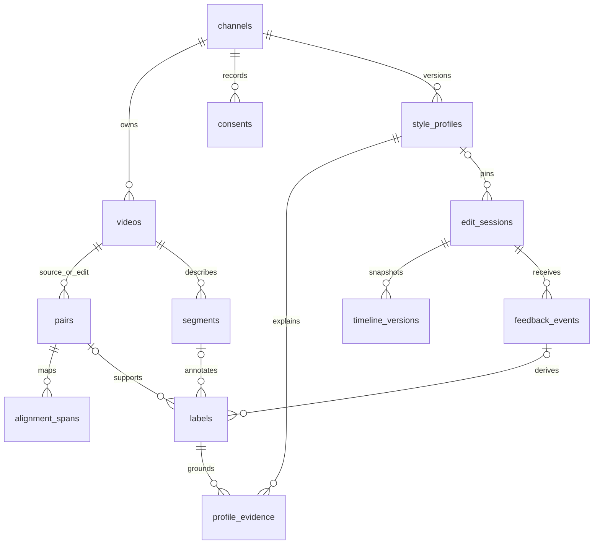

# Cutline: 편집 스타일의 측정과 학습 DB

작성·웹 확인: 2026-11-20. 연구 및 구현 제안 문서이며 새 모델 학습·영상 평가 결과가 아니다. 논문·저자 저장소·공식 문서를 근거로 사용했다. 아래의 [제안] 수치와 일정은 Cutline의 초기 설계값이다.

## Executive summary — 1페이지

**정의.** 편집 스타일은 “재미있는 느낌” 한 가지가 아니라, **같은 장르·출력 형식·목표 길이·내용 조건에서 반복되는 편집 선택의 분포**다. 무엇을 남기는지, 얼마 동안 보여주는지, 발화·반응 전후 어디서 자르는지, 어떤 순서로 배치하는지, 자막·줌·b-roll을 언제 쓰는지로 나눈다. 원본→편집본의 시간 매핑으로 선택·길이·순서를 관측하고, 전사·음향 이벤트·채팅과 연결해 조건부 경향을 추정한다. 편집 이유와 미제공 영상의 정답은 관측되지 않는다. 이런 분해는 편집 idiom, cut plausibility, 개인화 highlight 연구에 근거하지만 **“채널 스타일 전체를 객관적으로 복제했다”는 뜻은 아니다**. [R1–R8](#9-참고문헌과-확인한-자료)

**방법.** 채널×장르×형식별로 동의받은 쌍을 모으고, 정렬 신뢰도와 검수 범위를 먼저 저장한다. 기본 내용 판단은 고정한 채 작은 style residual만 더한다. 예: `score = clip(base + gate × shrinkage × clipped_delta, 0, 1)`. 길이 예산·문맥 보존·사람의 확정 선택은 별도 제약이다. 소표본이면 보정 0 또는 사례 검색만 제공한다. 정렬 안 된 부분을 확정 drop으로 바꾸지 않는다. generated `style.md`는 근거 타임스탬프·표본 수·반례·불확실성을 함께 전달하고, agent 도구는 위반 항목과 유사 사례를 반환한다. 이 방식의 Cutline 품질 향상은 **검증할 가설**이다.

**이미 확인된 실패.** 기존 `LEARN_REPORT.md`에서 평가 가능한 동일 채널 원본 3개의 macro 시간 F1은 **0.1205→0.0723**으로 하락했다. 게임 프로필을 스터디에 적용한 출력은 **5.79초/3217.47초**, 삭제 **99.82%**였다. 전체 코퍼스는 원본 4개·편집 쌍 6개·채널 2개였으며 “쌍 3개로 성공”이라는 설명은 부정확하다. 후속 `STYLE_REPORT.md`는 bounded adjustment와 장르 차단을 구현했으나 F1은 **0.086883→0.086970**, 차이 **+0.000087**에 불과하다. 후속 기본선이 달라 앞선 점수와 직접 비교할 수 없다. 채팅은 네 원본 모두 미확보, 웃음은 의미 검출이 아닌 음향 proxy, 질문 UI는 합성 fixture였다. 일반화·사람 선호 개선 증거는 없다. [L1–L4](#로컬-자료-읽기-전용)

**평가.** 원본 방송 단위로 train/validation/test를 분리한다. 동일 원본의 재인코딩·쇼츠·긴 편집본은 같은 split에 둔다. no-style base, 동일 길이 random, 단순 무음 제거와 비교한다. 시간 P/R/F1, 경계 오차, 출력 길이, clip-length Wasserstein distance, 내용 유형별 보존율을 보고한다. 마지막 판단은 창작자 블라인드 A/B의 “내 채널답다”와 “내용이 잘 전달된다”를 분리한 응답이다. F1만으로 스타일을 입증할 수 없다는 근거가 있다. [R15](https://arxiv.org/abs/1903.11328)

**빌드 범위.** SQLite 13개 테이블, CPU int8 ASR, Silero VAD, audfprint 기반 정렬 후보+수동 검수, 고정 embedding의 사례 검색, 버전별 profile·timeline·feedback이면 수일 내 수직 흐름을 만들 수 있다는 [개발 추정]이다. 정렬/특징은 사전 준비하고 첫 데모는 하나의 채널·장르·형식으로 제한한다. 3–5개 독립 원본은 기능 시연, 10–20개는 탐색 파일럿, 30–50개는 후속 수집 계획값이다. 어떤 숫자도 보편적 표본 충분성 보장이 아니다.

**근거와 가설의 경계.** 개인 이력으로 highlight를 조건화하는 연구, 컷 타이밍·편집 효과를 모델링하는 연구, CPU 실행 도구는 존재한다. 한국어 크리에이터 3쌍에서 안정적으로 스타일을 학습하거나 편집 시간을 줄인다는 근거는 아직 없다. 제품 경로는 창작자 동의 업로드이며, 연구용 공개 영상도 자동 수집·학습·재배포 권리를 자동으로 주지 않는다.

## 1. 연구·산업에서 “editing style”을 어떻게 조작화하는가

### 1.1 스타일과 과제를 분리하는 정의

[제안] `P(action, duration, boundary, order, effect | content, channel, editor, genre, format, target_duration)`를 스타일의 관측 모델로 정의한다. `action`은 keep/drop뿐 아니라 축약·이동·반복·오버레이다. 영상의 재미, 인물의 성격, 촬영 스타일, 편집 스타일은 구별한다. 공개 채널에서 보이는 차이는 원재료·게임·시청자·편집자·출력 길이에 의한 것일 수도 있다. 동일 콘텐츠 조건의 base와 비교한 **조건부 차이**만 개인화 후보로 취급한다. 인과적 편집 의도를 식별했다고 주장하지 않는다.

연구의 예는 다음과 같다. Leake 등은 대사별 shot 선택을 촬영 구도·감정과 연결한 편집 규칙 조합으로 표현한다. Pardo 등은 실제 컷과 인위적 컷의 타당성 순위를 학습한다. Frey 등은 framing·content type·speed·lighting을 편집 스타일 전이 요소로 사용한다. 각각의 범위가 전체 크리에이터 편집보다 좁다. [R1](https://graphics.stanford.edu/papers/roughcut/), [R2](https://arxiv.org/abs/2108.04294), [R3](https://research.google/pubs/automatic-style-transfer-for-non-linear-video-editing/)

산업의 실제 조작 단위 역시 구체적이다. Premiere의 Text-Based Editing은 전사에 연결된 pause·filler·speaker 구간을 찾아 삭제하도록 한다. Auto-Editor는 음량 등 분석 결과로 first-pass 편집을 수행한다. 이는 구현 가능한 동작의 근거이고, 각 제품이 채널 스타일을 학습한다는 근거는 아니다. [Adobe 공식 문서](https://helpx.adobe.com/premiere/desktop/edit-projects/edit-video-using-text-based-editing/detect-and-delete-pauses-in-transcripts.html), [Auto-Editor](https://github.com/WyattBlue/auto-editor)

### 1.2 측정 항목과 쌍에서 학습 가능한 범위

| 축 | 측정 정의·단위 | 원본→편집본에서 얻는 것 | 교란·추가 주석 | MVP |
|---|---|---|---|---|
| 내용 선택 | 유형별 retained source seconds / available seconds; keep probability | 정렬된 keep, 검수 범위 내 unselected | 반응/설명/준비/반복/질문/침묵 유형은 다중 라벨; 미채택≠무가치 | 핵심 |
| 압축 | unique source kept / eligible source; edited duration / source duration | 보존율·배속·반복의 영향 분리 | 쇼츠와 긴 영상 분리; edit 길이는 source keep 길이와 다름 | 핵심 |
| clip 길이·pacing | p10/p50/p90, IQR, cut/min, 무음 비율, 30초 창별 cut density | 출력 shot 길이와 원본 연속 keep run 길이를 따로 추정 | 오디오 정렬 조각 길이가 실제 시각 shot 길이는 아님 | 핵심 |
| 컷 경계 | 발화 시작/끝·웃음 onset/offset·chat peak와 cut 간 signed offset(ms) | 이벤트 전후 패딩 분포 | 채팅 지연, ASR 오차, 웃음/게임음 혼동; J/L cut | 발화 우선 |
| 순서·재구성 | source 역행 전환율, 반복률, 공통 사건 순서의 Kendall τ | edit order와 source order의 차이 | 동일 장면 replay, 여러 원본, 외부 footage | 저장; 적용 후순위 |
| hook | 첫 의미 hook의 출력 시각/전체 길이, 첫 15–30초의 사건 유형 | 원본 후반 사건의 앞당김, hook 반복 여부 | hook 의미는 사람 주석 필요; 첫 컷=hook 아님 | 수동 마커 |
| b-roll | 삽입 초/출력 분, 발화와의 상대시각, source coverage | A/V 매핑 불일치와 삽입 후보 | 추가 미디어·원래 삽입 여부 구별; 영상 track 필요 | 수동 |
| zoom/crop | scale, 중심 이동, 지속시간, 이벤트 전후 빈도 | 정렬 프레임의 상대 변환 후보 | 카메라 줌·게임 UI·레이아웃과 편집 줌 혼동 | 후보만 |
| captions | 화면 점유율, 위치, 글자 수/초, onset offset, 강조 비율 | OCR/렌더 차분 후보 | 원본 자막·HUD·OCR 실패; 폰트 자산 권리 | 스타일 수동 입력 |
| 음악/SFX | 삽입 빈도/출력 분, 레벨, 반응 대비 offset | 원본 대비 오디오 변화 후보 | EQ·압축·게임 BGM·더빙; 잔차≠SFX 확정 | 수동 마커 |

표는 위 연구를 참고한 **Cutline 제안 측정 사전**이며 검증된 표준 척도라는 주장은 아니다. 분모를 항상 함께 보관한다. 예컨대 반응 장면이 대부분인 원본에서 반응을 많이 남긴 사실만으로 “반응 선호”라 하지 않는다. 출력 분당 효과 빈도와 원본 분당 빈도를 혼용하지 않는다.

### 1.3 쌍을 라벨로 만드는 절차

1. 파일 hash·duration·timebase·source_group·출력 목적·권리·편집자를 등록한다. 원본이 정말 촬영 마스터인지 이미 잘린 VOD인지 구분한다.
2. 오디오 fingerprint로 편집본의 짧은 창과 원본 위치의 후보를 찾고, transcript anchor/국소 파형 상관으로 보완한다. `source_time = a × edit_time + b`의 **piecewise** mapping을 만든다. `a`는 속도 비율이며 전체 영상에 하나의 offset을 쓰지 않는다.
3. 첫 MVP는 1배속 hard-cut 구간부터 검수한다. 배속·더빙·음악 덮임·반복·외부 b-roll은 미정으로 남긴다. 후속에는 배속 후보 탐색/국소 DTW를 추가하되 전체 원본×편집본의 dense DTW를 돌리지 않는다.
4. edit 순서대로 span을 저장한다. source 순서는 역행·반복 가능하다. J/L cut은 audio/video track 매핑을 분리한다. 정렬 누락, ambiguous match, 외부 삽입을 `unmatched/uncertain`으로 남긴다.
5. [제안 검수량] 쌍마다 모든 불확실 경계 + 무작위 matched 20개·unselected 20개를 사람이 확인한다(그보다 적으면 전수). precision·coverage·경계 오차를 보고한다. confidence는 자동 정답 확률로 간주하지 않는다.
6. 검수된 mapping의 source 합집합은 해당 **편집 과제에 대한** keep이다. 보완집합은 우선 `unselected`; 모든 편집본의 정렬/입력 범위가 충분히 검수된 경우에만 약한 negative로 학습한다. unknown은 loss에서 마스크한다. 원본 한 개에 여러 format이 있으면 별도 과제로 저장한다.

쌍만으로는 “왜 버렸는지”를 복원할 수 없다. editorial reason은 실제 editor의 입력과 모델 추정을 별도 출처로 저장한다. 삭제된 장면이 낮은 품질인지, 길이 제한 때문인지, 권리 때문인지, 중복 때문인지 구분되지 않는 사례는 abstain한다.

## 2. 핵심 관련 연구 15편

아래 적용 설명은 우리의 설계적 해석이다. 논문의 다른 도메인 성능 수치를 Cutline 예상 성능으로 옮기지 않는다.

| ID · 연구 | 한 줄 takeaway | Cutline 적용·한계 |
|---|---|---|
| R1 Leake et al., **Computational Video Editing for Dialogue-Driven Scenes**, SIGGRAPH 2017 | 대사에 정렬된 take와 editing idiom 조합으로 shot 선택 | 설명 가능한 규칙·순서 제약의 선례; 다중 take 대화 장면 연구 |
| R2 Pardo et al., **Learning to Cut by Watching Movies**, ICCV 2021 | 실제/인공 컷을 contrastive하게 비교하여 cut plausibility 순위 학습 | “내용 선택”과 “어디서 잇는가”를 분리; 영화 컷은 스트리머 keep 정답이 아님 |
| R3 Frey et al., **Automatic Style Transfer for Non-Linear Video Editing**, CVPR AICCW 2021 | framing·내용·속도·조명을 매칭해 시각/시간 편집 스타일 전이 | 효과·속도 축의 선례; 채널의 의미 선택까지 검증한 것은 아님 |
| R4 García del Molino & Gygli, **PHD-GIFs: Personalized Highlight Detection for Automatic GIF Creation**, ACM MM 2018 | 사용자별 과거 GIF 선택을 개인화 단서로 사용 | 원본 위치·사용자·선택 이력 DB의 직접적 선례; GIF 소비자와 채널 editor는 다름 |
| R5 Rochan et al., **Adaptive Video Highlight Detection by Learning from User History**, ECCV 2020 | history encoder와 T-AIN으로 highlight 예측을 사용자에 맞춤 | base와 personalization의 분리 동기; 해당 신경망을 노트북에서 재학습할 필요 없음 |
| R6 Chen et al., **PR-Net: Preference Reasoning for Personalized Video Highlight Detection**, 2021 preprint | 현재 프레임별로 관련 history를 가중해 다양한 취향을 반영 | 하나의 채널 벡터 대신 관련 사례 검색; 불완전 주석 문제를 고려 |
| R7 Sharghi et al., **Query-Focused Video Summarization: Dataset, Evaluation, and a Memory Network Based Approach**, CVPR 2017 | query로 요약 목적을 조건화하고 의미 개념 기반 평가 제안 | “이번 영상의 목적”을 채널 취향과 별도 입력; 시간 겹침 외 내용 검수 |
| R8 Lei et al., **QVHighlights: Detecting Moments and Highlights in Videos via Natural Language Queries**, NeurIPS 2021 | query 관련 구간 검색과 saliency를 함께 다룸 | `find_moments`와 선택 점수를 구분; query retrieval≠개인화 |
| R9 Song et al., **TVSum: Summarizing Web Videos Using Titles**, CVPR 2015 | 50개 영상·영상당 20명 중요도 주석 | 평가 파이프라인 sanity check; 특정 채널 스타일의 정답은 아님 |
| R10 Fu et al., **Video Highlight Prediction Using Audience Chat Reactions**, EMNLP 2017 | eSports 영상과 영어/번체 채팅의 결합 예측 | 채팅 속도뿐 아니라 의미·은어도 후보 특징; 한국어 전이 검증 필요 |
| R11 Jiang et al., **Towards Extracting Highlights From Recorded Live Videos: An Implicit Crowdsourcing Approach**, ICDE 2020 | Lightor가 채팅으로 위치를 초기화하고 사용자 행동으로 정제 | 저비용 후보 생성·반응 지연·피드백 정제; 채팅만으로 editor 정답을 만들지 않음 |
| R12 García del Molino et al., **Active Video Summarization: Customized Summaries via On-Line Interaction with the User**, AAAI 2017 | 편집 중 질문으로 요약 선호를 갱신 | “이 구간”과 “비슷한 구간도”를 구분해 물음; 6질문 성과를 우리에게 보장하지 않음 |
| R13 Christiano et al., **Deep Reinforcement Learning from Human Preferences**, NeurIPS 2017 | 짧은 trajectory 쌍의 선호로 reward 학습 | A/B 비교 라벨의 근거; MVP는 작은 pairwise ranker만, RL/LLM fine-tuning 없음 |
| R14 Snell et al., **Prototypical Networks for Few-shot Learning**, NeurIPS 2017 | embedding에서 class prototype까지 거리로 소표본 분류 | 고정 embedding 사례/prototype 비교의 발상; few-shot 채널 편집 성능의 직접 증거 아님 |
| R15 Otani et al., **Rethinking the Evaluation of Video Summaries**, CVPR 2019 | random 요약과 segmentation이 기존 F-score 평가를 교란 | same-budget random·고정 segmentation·사람 평가 필수 |

## 3. 오픈소스 구성요소와 16 GB Windows/CPU 타당성

라이선스·기능은 링크된 공식 페이지 확인 기준이다. **성숙도와 CPU 적합성은 문서에 근거한 판단이며 이 PC의 벤치마크가 아니다.** 저장소 라이선스가 모든 checkpoint·훈련 데이터·FFmpeg build에 그대로 적용되지는 않는다. 설치 전 commit/revision·LICENSE·모델 카드 hash를 고정한다.

| 기능 / 후보 | 라이선스 구분 | 성숙도·Windows/CPU 판단 | 결정 |
|---|---|---|---|
| [faster-whisper](https://github.com/SYSTRAN/faster-whisper) | 코드 MIT; 선택 checkpoint 카드 별도 확인 | 운영 활용도가 높은 CTranslate2 구현, CPU int8·word timestamps 지원. 공식 small int8 CPU 표는 약 1.5 GB RAM이나 다른 CPU/입력의 수치 | **base 또는 small 다국어**, 순차 처리. tiny는 빠른 preview용 |
| [WhisperX](https://github.com/m-bain/whisperX) | 현재 코드 BSD-2-Clause; alignment/diarization 모델 별도 | forced alignment와 word timestamp 보완, CPU 옵션 명시. 의존성·언어별 alignment 모델 추가 | 경계 품질이 병목일 때. 한국어 모델·숫자·겹말은 수동 검증 |
| [Silero VAD](https://github.com/snakers4/silero-vad) | MIT, repo의 제공 VAD 모델 포함 설명 | ONNX/PyTorch CPU 경로, 작은 모델; 음성 여부이지 의미 중요도 아님 | **채택**, 음성/무음 후보·단어 보호 보조 |
| [pyannote.audio](https://github.com/pyannote/pyannote-audio) + [community-1](https://huggingface.co/pyannote/speaker-diarization-community-1) | 코드 MIT, 해당 pipeline CC-BY-4.0, 접근 조건 동의 필요 | 대표 diarization toolkit, CPU 기본 경로 가능. 긴 파일은 지연·메모리 측정 필요, Windows 오디오 의존성 확인 | 다인 대화에만 후속. 한 진행자는 생략; speaker alias는 실명 식별 아님 |
| [YAMNet](https://www.tensorflow.org/hub/tutorials/yamnet) | TF models 코드 Apache-2.0; 사용할 배포 모델 카드도 고정 | 521 AudioSet event class와 embedding, 가벼운 MobileNet 계열. laughter score는 대리신호; TF Windows CPU 패키지 조합 확인 | **선택 추가**, 수동 laughter 검증 후 사용 |
| [PANNs](https://github.com/qiuqiangkong/audioset_tagging_cnn) | 코드 MIT; 개별 배포 weight 조건 별도 확인 필요 | 오디오 tagging 연구 구현, PyTorch CPU 가능하나 Cnn14 등 무거운 구성 | YAMNet 대안 비교 연구, 초기 필수 아님 |
| [PySceneDetect](https://github.com/Breakthrough/PySceneDetect) | BSD-3-Clause; 디코더 별도 | 문서·Windows 배포 있는 CPU 도구, content/adaptive detection | 출력 shot 통계에 **선택**, 저해상도 순차 decode; 움직임=편집 컷 아님 |
| [Moment-DETR](https://github.com/jayleicn/moment_detr) / [Lighthouse](https://github.com/line/lighthouse) | MIT / Apache-2.0; QV 주석 CC-BY-NC-SA-4.0; backbone/weight 개별 확인 | 전자는 연구 기준 구현, 후자는 여러 모델의 재현 wrapper. 비디오 feature extraction이 큰 비용, Windows CPU 전체 경로 검증 안 됨 | 사전 feature 기반 연구 비교만; 최소 제품에서 제외 |
| [audfprint](https://github.com/dpwe/audfprint) | MIT | 오래된 landmark fingerprint 구현; CPU 가능. Windows FFmpeg·Python 의존성 통합 검증 필요 | **정렬 후보 생성 채택**, 짧은 noisy excerpt 매칭 후 경계 수동 검수 |
| [Chromaprint](https://github.com/acoustid/chromaprint) | LGPL-2.1 계열; FFTW3 build는 GPL 영향 | 성숙한 C 라이브러리/fpcalc. 공식 설명은 near-identical 전체 파일/긴 스트림 식별 중심 | 중복 확인 보조. 짧은 컷·변속의 정밀 정렬 주력으로 쓰지 않음 |
| [Auto-Editor](https://github.com/WyattBlue/auto-editor) | 현재 repo Unlicense; bundled deps 별도 | CLI로 무음 등 first-pass editing; 버전별 runtime/export 호환 확인 | baseline 또는 참고. 자체 timeline 제어를 위해 핵심 의존성은 생략 |
| [multilingual-e5-small](https://huggingface.co/intfloat/multilingual-e5-small) | 모델 MIT | 한국어 포함 다국어 text embedding, CPU 소배치 가능. prefix·토큰 상한 준수, 의미 보존은 보장 안 됨 | **선택 채택**. 처음은 SQLite FTS5/BM25로도 시작 가능 |
| [LAION CLAP](https://github.com/LAION-AI/CLAP) | repo CC0-1.0; 선택 checkpoint·하위 deps 조건 별도 | text/audio 공동 embedding 연구 구현, CPU 추론은 가능하나 무겁고 Windows 설치 경로 미검증 | 오디오 사례 검색 후속, 실시간 약속 금지 |
| [FFmpeg](https://ffmpeg.org/legal.html) | 기본 LGPL-2.1+; GPL 옵션/외부 library에 따라 달라짐 | Windows CPU decode·resample·probe 성숙 | **채택**. 배포 build 설정/고지 기록 |

### 최소 스택과 자원 예산

[제안] `FFmpeg → faster-whisper(base/small, cpu/int8) + Silero → audfprint 후보 정렬 → 수동 검수 → SQLite → 작은 선형 residual + 사례 검색 → style.md/tool`. 웃음·diarization·shot 분석·CLAP·video transformer는 feature flag로 뒤에 추가한다. 자막/줌은 첫 버전에 creator 입력 숫자와 수동 근거 마커로 저장한다. LLM을 쓰면 이미 있는 agent가 전사와 근거를 해석하지만, 이것은 로컬 CPU에서 같은 LLM이 실행된다는 뜻이 아니다.

60초 audio chunk, 최대 하나의 ASR 모델, 2–4 CPU thread, 소배치 embedding, hash/model revision 캐시를 권장한다. 16 kHz mono float32 PCM 60초는 약 3.84 MB이며 4시간 전체는 약 922 MB다. 한 번에 긴 PCM·영상 frame 배열을 올리지 않는다. [설계 예산] worker peak RSS 4 GB 이내를 목표로 잡고 OS/IDE/브라우저 여유를 남긴다. 실제 허용 모델 크기·RTF·한국어 CER/WER·경계 오차는 10분 consent clip에서 먼저 측정한다. 전사 처리 범위 100%와 인식 정확도 100%는 다르다. 이번 작업에서는 미디어 다운로드·설치·추론을 수행하지 않았다.

정렬을 정답 생성기에 바로 연결하는 것이 가장 위험한 단축이다. creator가 EDL/XML/타임라인 파일을 같이 제공할 수 있으면 그것을 1차 mapping으로 쓰고, export 당시 버전·speed·중첩 track을 검증한다. 오디오 fingerprint는 EDL 없는 쌍의 보조 경로다.

## 4. 공개 데이터셋과 권리

“raw”는 웹 원영상일 수도 있고 카메라 마스터일 수도 있다. human summary·GIF 선택·영화 컷·효과 인식 데이터는 서로 다른 정답이다. **본 조사에서 라이선스가 명확하고 한국어 채널별 완전한 촬영 마스터→업로드 편집 쌍을 제공하는 범용 데이터는 확인하지 못했다.** 그런 데이터가 없다는 전수조사 결론은 아니다.

| 데이터 | 실제 제공 단위·용도 | 라이선스·접근 확인 | Cutline 사용 판단 |
|---|---|---|---|
| [TVSum](https://github.com/yalesong/tvsum) | 50 web videos, 2초 단위 중요도, 20명/영상 | 공식 README는 영상 CC-BY 3.0 명시. 주석에 대한 별도 명확한 허가 문구는 재사용 전 확인 | generic ranking/평가 sanity check. 채널 개인화 증거로 사용 불가 |
| [SumMe 저자 페이지](https://gyglim.github.io/me/vsum/index.html) | 25 user videos와 여러 human summaries로 알려진 benchmark | 이번 공식 페이지 접근 실패. **현행 원문 라이선스 미확인**, 제3자 “research-only” 설명을 확정 근거로 대체하지 않음 | 비교 후보만. 원 배포 README/권리 확인 전 취득·재배포 보류 |
| [QVHighlights](https://github.com/jayleicn/moment_detr/tree/main/data) | 자연어 query, 관련 시간 구간, saliency 주석 | 주석 CC-BY-NC-SA 4.0, 코드 MIT. 영상 권리는 별도; NC 주석을 상업 학습용으로 자동 전용하지 않음 | retrieval 평가용 연구 트랙 |
| [PHD2 / PHD-GIFs](https://github.com/gyglim/personalized-highlights-dataset) | 사용자별 YouTube ID·GIF start/duration·과거/마지막 선택. 내부 timestamp여서 시각 재정렬 불필요 | 확인한 repo에 명시적 LICENSE 없음. 영상 파일 권리도 별도, 링크 소실 가능 | 개인화 split 설계의 가장 가까운 공개 선례. 이용 허가 확인 필요 |
| [RoughCut](https://graphics.stanford.edu/papers/roughcut/) | 대본·복수 take에 대한 편집 결과와 professional hand edits 자료 | 페이지의 공개 열람과 학습/재배포 허가는 별개; 명시적 전체 corpus license 미확인 | paired editing 사례 연구, 공개 학습 corpus로 가정하지 않음 |
| [Learning to Cut / AVE](https://arxiv.org/abs/2108.04294) | 이미 편집된 10K+ 영상에서 255K+ 컷을 추출한 연구 | 논문 공개 라이선스는 원 영화/영상 이용 허가가 아님; corpus 배포 라이선스 미확인 | cut ranking 전용; raw의 버려진 부분을 알 수 없음 |
| [Fu et al. eSports](https://aclanthology.org/D17-1102/) | LoL 방송·영어/번체 Twitch 채팅·highlight 예측 | 논문은 연구 공개 예정이라고 설명. 현행 데이터 배포·별도 license 확인 못함 | chat ablation 설계 참고, 즉시 사용 가능 데이터로 계산하지 않음 |
| [CSumm / Active Video Summarization](https://github.com/GarciaDelMolino/active-video-summarization) | 개인 egocentric summary와 질문형 편집 연구 자료 | 코드 GPL-3.0; 영상·annotation에 같은 license가 적용된다고 단정 불가 | interactive protocol 참고; 제품 코드 복사 없이 설계 활용 |

최근 편집 이해 benchmark도 raw→final과 동일하지 않다. [VEU-Bench 공식 논문](https://openaccess.thecvf.com/content/CVPR2025/papers/Li_VEU-Bench_Towards_Comprehensive_Understanding_of_Video_Editing_CVPR_2025_paper.pdf)은 shot·cut·transition 등 편집 이해를 구분한다. effect/transition 영상과 QA가 있다고 해서 삭제된 원본 장면이나 editor의 선택 이유가 제공되는 것은 아니다. 데이터 schema·권리·원본 availability를 확인하기 전 pair 학습에 사용할 수 있다고 말하지 않는다.

[제안] 공개 benchmark는 평가 코드 검증용, 제품 효과 평가는 creator opt-in corpus로 분리한다. creator별 같은 장르·format 원본과 final, 가능하면 EDL, 편집 의도·목표 길이, 선택적 10–20개 이유 주석을 받는다. 별도의 공개 데모 동의가 없는 쌍은 pitch에 영상·원고를 노출하지 않는다.

## 5. 평가 프로토콜과 필요한 표본

### 5.1 평가 단위·누출 방지

주 실험 질문은 “**새 원본에서 같은 base와 길이 예산에 채널 보정을 더하면 creator의 선택·선호와 더 잘 맞는가?**”다. 원본/source_group이 독립 단위다. 같은 방송에서 나온 쇼츠 10개를 독립 표본 10개로 세지 않는다. 같은 원본을 여러 부분으로 나눠 train/test에 배치하지 않는다. 스케일러·prototype·feature 선택·threshold·보정 강도·패딩·예산·prompt 사례 모두 train에서 만들고 validation에서 선택한다. test의 최종 edit/전사 요약을 profile 예시로 넣지 않는다.

초기에는 group leave-one-source-out 결과를 전부 공개한다. 충분해지면 시간순 train/validation/test로 미래 원본을 test에 둔다. 장르·형식·creator별 결과와 전체 macro를 병기한다. 출력 형식이 다른 edit를 OR 합쳐 정답 길이를 부풀리지 않는다. 복수 editor의 유효 대안은 reference별 점수를 계산해 평균·분산을 보고하며 최고 점수만 선택하지 않는다.

### 5.2 지표와 정의

평가 가능 source mask를 `M`, 예측 source keep의 합집합을 `K`, 해당 reference의 검수 keep를 `H`라고 한다. `TP=duration(K∩H∩M)`, `P=TP/duration(K∩M)`, `R=TP/duration(H∩M)`, `F1=2PR/(P+R)`. millisecond 경계로 정확한 교집합 길이를 계산하고 사람이 볼 때 초 단위로 보고한다. 1초 bin 도식은 표시용이며 5초 창 개수를 시간 F1로 대체하지 않는다. `K=∅, H≠∅`이면 F1=0, `H=∅`인 과제는 별도 empty-target 집계로 주 F1에서 제외한다. 알려진 H가 없다는 것과 실제 H가 비어 있다는 것을 구분한다.

| 항목 | 보고 방법 | 해석상 주의 |
|---|---|---|
| 선택 일치 | source별 P/R/F1, macro 평균·source bootstrap 95% CI; micro 보조 | 반복 장면은 source 합집합에서 한 번만 계산; 순서/배속 반영 안 됨 |
| 범위 신뢰도 | M의 길이/전체 길이, 정렬 precision 검수, unknown 시간 | 높은 점수가 작은 쉬운 M에서 나온 것인지 함께 표시 |
| 경계 | reference와 예측 start/end의 one-to-one 매칭, median/p90 absolute error; ±0.5/1/2초 boundary F1 | unmatched boundary도 FP/FN 집계. 근처 경계 하나에 여러 예측 붙이지 않음 |
| 길이·pacing | 출력 길이 오차(%), unique keep 비율, clip-length Wasserstein-1(초), cut/min 차이 | source run, output shot, alignment span 각각 분리. Wasserstein은 형식/길이 조건 고정 |
| 내용 선택 | 유형별 keep rate, content-type 분포 JS divergence, 중요 사건 recall | event/유형은 사람이 검수한 subset에서 측정; 대리신호만으로 semantic recall 주장 금지 |
| 순서·hook | 공통 사건 순서 τ, replay 비율, hook 시작 오차; 창작자 coherence 평점 | 공통 사건이 2개 미만이면 τ=N/A; 단순 source 역행은 나쁜 편집이라는 뜻 아님 |
| 효과 | 수동 주석 subset의 zoom/caption/SFX event P/R, onset error, rate/min | 효과 없는 baseline과 구분; candidate 탐지를 확정 효과로 세지 않음 |
| 사람/작업 | channel-style A/B 선호, 내용 품질, 수정 시간, 되돌림 비율, 중요 내용 오삭제 | accept가 완전 시청/품질 검증을 뜻하지 않음; 노출량·검토 여부 기록 |

여러 지표를 가중 평균한 “스타일 92점”은 초기에는 내놓지 않는다. 품질 지표가 악화되면 분포가 비슷해져도 성공이 아니다. 스타일 도구의 분포 거리는 학습 원본의 분포와 비교하며 새 영상의 숨겨진 정답을 필요로 하지 않는다. 최종 성능 평가는 별도 test reference와 비교한다. [평가 한계 근거 R15](https://arxiv.org/abs/1903.11328)

### 5.3 기본선·ablation

1. **No-style base**: 내용 판단, candidate segmentation, 단어 보호, selector, 길이 제약을 모두 고정한다. style delta만 0이다. 규칙 base인지 LLM base인지 명시하고 버전·prompt·seed를 저장한다.
2. **Random at same length**: 같은 candidate pool·selector·길이 예산, 무작위 점수 100 seed [제안]. 길이만 맞춘 random과 clip-length까지 맞춘 stronger random을 각각 보고한다. 예산 오차 허용은 사전 ±5%로 고정한다. reference 길이를 쓰는 oracle-budget 실험은 모든 arm에 똑같이 주고 실제 사용 길이 실험과 분리한다.
3. **Silence baseline**: VAD/음량 기반 first-pass. 이 결과를 의미 base와 혼용하지 않는다.
4. **Length-only / shuffled-style**: 내용 보정 없이 pacing target만 적용, 같은 genre/format에서 다른 채널 profile을 적용하는 통제 연구. 올바른 채널이 다른 채널보다 낫지 않으면 개인화 주장은 약하다. 제품에서는 잘못된 채널 프로필 적용을 차단한다.
5. **Ablation**: base+selection delta, +boundary/pacing, +verified chat, +human feedback. 없는 chat은 zero feature가 아니라 unavailable이며 해당 ablation은 N/A다.

offline 미래 원본 일반화와 online 같은 원본 적응을 나눈다. online은 0/3/5/10개 질문의 효용 곡선을 그리되 oracle 응답과 실제 사람 응답을 분리한다. 질문으로 정답을 알려준 범위를 포함한 결과와 제외한 고정 audit 구간 결과를 함께 보고하고, 다음 unseen 원본으로 전달되는 효과를 따로 측정한다. 무제한 전역 bias 갱신보다 영향을 받은 내용 유형/이웃 사례에 국소 갱신하는 방식을 비교한다.

### 5.4 인간 A/B 프로토콜

[제안] 한 채널의 실제 creator/editor를 주 평가자로, 해당 채널을 아는 2–3명은 보조 평가자로 둔다. 먼저 train 영상 2개로 해당 채널의 예시를 공유하되 test 정답 편집은 보여주지 않는다. 동일 source·동일 brief·같은 목표 길이의 base와 base+style 결과를 익명 A/B로 표시하고 순서를 무작위·균형 배치한다. 가능한 한 전체 편집본을 평가하고, 짧은 block 평가이면 서사 전체 품질을 검증하지 못한다는 한계를 표시한다.

각 비교에서 ① “어느 쪽이 우리 채널의 편집 선택에 가까운가?” ② “어느 쪽이 내용 전달/재미/문맥에 좋은가?”를 별도로 묻고 A/B/동률/판단불가를 허용한다. 선택 이유는 selection/pacing/boundary/effect 중 선택 + 자유문장으로 받는다. 원본 문맥 재생은 양쪽 같은 조건으로 제공한다. 반복 문항 약 10%로 일관성을 확인하되 피로·일관성 기준은 결과 보기 전에 고정한다. 생성 arm을 밝히거나 결과를 유도하지 않는다.

win/tie/loss와 `(wins + 0.5×ties)/유효응답`을 함께 보고한다. source별 평균 후 집계하고 viewer·source 반복 측정을 고려한 CI/혼합효과 분석을 사용한다. 한 source에 20명이 답했다고 독립 원본이 20개가 되지 않는다. profile 튜닝에 쓴 사람 답변은 test 선호 결과에 다시 쓰지 않는다. 각 arm 편집을 고치는 시간을 별도 교차 배치 실험으로 재고 학습/순서 효과를 상쇄한다.

### 5.5 몇 쌍이 필요한가

보편적 최소 N은 없다. 효과 크기, 원본 다양성, 정렬 오류, 동일 source 상관, 모델 자유도에 따라 달라진다. frame/5초 window가 수천 개여도 독립 원본 3개는 3개다. 다음은 **문헌이 보장한 임계값이 아닌 수집 계획**이다.

| 단계 | 같은 채널×장르×format의 독립 원본 수 | 허용 주장 |
|---|---:|---|
| 기능 demo | 3–5 | 정렬→근거→profile→피드백 갱신 동작. 성능 일반화 주장 안 함 |
| 탐색 pilot | 10–20 | source별 결과·오류 유형·learning curve·분산 추정. holdout이 작으면 CI 불안정 명시 |
| 후속 검증 | 30–50+ | 예: 20 train/10 validation/20 locked test(50개일 때). power 재계산 후 확정 |
| 채널 일반 주장 | 여러 creator 반복 | 한 채널 성과를 전체 creator에 일반화하지 않음 |

paired source-level F1 차이의 표준편차를 `s_d`, 검출할 평균 차이를 `δ`라고 하면 양측 α=.05, power .8의 정규 근사 `n ≈ ((1.96+0.84)×s_d/δ)^2`로 계획할 수 있다. **가정** `s_d=.10, δ=.05`이면 약 32개 독립 test source다. F1의 비정규성·작은 n에는 pilot bootstrap/simulation으로 재계산한다. 기존 3개 fold로 이 분산을 신뢰성 있게 추정할 수 없다.

A/B의 독립·동률 없는 비교에서 p=.65를 .50과 구별하려면 같은 근사로 약 85개 비교가 필요하고, p=.60이면 약 194개다. 반복 source/viewer는 유효 표본을 줄이므로 더 필요하다. 이 숫자를 “85개 clip이면 충분”으로 바꾸지 않는다. 해커톤에서는 가능한 수를 투명하게 공개하고 기능 시연과 탐색 결과까지만 말한다.

## 6. DB 설계와 기존 MVP 비교

### 6.1 선택: 로컬 SQLite부터

동봉 `schema.sql`은 SQLite 3.38+ JSON 함수, millisecond 정수 범위, 연결별 foreign key 검사를 사용한다. 미디어 바이트는 DB 밖, DB에는 불투명 참조·hash·시각·검수 상태를 둔다. 13개 테이블이며 embedding은 초기 수천 segment 수준에서 JSON/소형 배열+cosine scan으로 충분하다는 설계 판단이다. 수백만 vector를 예상해 별도 vector DB부터 운영하지 않는다.

| 선택 | 장점 | 한계·이행 |
|---|---|---|
| SQLite | 설치 서비스 없음, IDE 로컬 파일·트랜잭션·backup 단순 | writer 하나, 앱이 채널/권리/JSON 의미 검사. 단일 사용자 전제 |
| PostgreSQL | 동시 편집·서버 권한·RLS·JSONB·향후 pgvector | 서비스·migration·auth 운영 비용. 협업 제품 단계에서 전환 |

SQLite→Postgres는 TEXT UUID→uuid, JSON TEXT→jsonb, UTC TEXT→timestamptz, SQLite trigger→PG function으로 바꾸고 org_id 복합 FK/RLS를 추가한다. 기존 PG의 billing·tenant 전체를 이 research prototype에 복사하지 않는다. 다중 사용자 서비스에 지금 DDL을 그대로 노출하지 않는다.



`evaluation_runs`는 위 graph 밖의 immutable manifest/result 기록이다. 각 run에 source split·profile/base ID·mask·seed·metric protocol을 고정한다. 이름이 같은 원본도 source_group/hash로 중복과 재인코딩 관계를 기록한다.

### 6.2 엔티티 계약

| 테이블 | 핵심 책임 |
|---|---|
| channels / consents | 채널 identity와 목적별 동의·고지·철회·범위. 업로더의 소유 선언만으로 출연자 권리까지 충족했다고 간주하지 않음 |
| videos | source/edited 구분, hash·duration·language·genre·format·editor·source_group·media_ref |
| pairs / alignment_spans | source↔edit 다대다, mapping version·coverage·검수; track별 비단조 시간 매핑 |
| segments | source/edited 시각별 transcript·word timestamp·speaker·audio events·chat rate·결측·feature revision |
| labels | 해당 pair/feedback 맥락의 keep/drop/unselected/unknown·soft fraction·이유 저자·confidence·supersedes |
| style_profiles / profile_evidence | 불변 version, base와 feature 버전, bound·shrinkage·targets·train manifest, 규칙별 근거와 반례 |
| edit_sessions / timeline_versions | task brief·고정 profile·agent/prompt 버전, stable clip ID와 타임라인 snapshot·부모·revision |
| feedback_events | accept/reject/revert/경계 조정/A-B/동률, 실제/implicit/oracle/synthetic 구분, request key·원인·전후 버전 |
| evaluation_runs | 실행 당시 데이터·split·프로필·평가 설정·원본별 결과·CI·N/A 사유 |

features JSON은 event마다 detector/model revision·confidence·available 여부를 포함한다. LLM content type과 수동 event truth를 구별한다. 예: `chat_rate=null, chat_available=false`는 `chat_rate=0, chat_available=true`와 다르다. 이유를 모르면 NULL이고 agent가 만든 설명으로 메우지 않는다.

### 6.3 기존 설계에서 유지·축소·변경

검토 자료는 `docs/schema.sql`의 **설계 DDL**과 LEARNING/STREAMER_STYLE 및 두 report다. 보고서의 실행 DB에는 `media_assets/media_pairs/feature_chunks/profile_versions` 등이 있으나 docs DDL은 `source_videos/historical_pairs/alignment_segments/style_profiles` 체계다. **둘이 같은 실제 schema라고 단정하지 않았다.** 허용 범위 밖 migration/code/DB에는 접근하지 않았다.

| 기존 항목 | 판단 | 이유·새 구조 |
|---|---|---|
| channel, hash, consent/provenance | 유지 | 권리·출처·채널별 통계의 핵심 |
| historical_pairs의 original/edited hash 직접 저장 | 정규화 | videos 공유 + pairs; 한 원본 여러 edit, 한 edit 여러 source 처리 |
| alignment_segments에 kept/discarded label와 mapping 혼재 | 분리 | alignment_spans는 시간 대응, labels는 편집 과제별 의사결정; unmatched≠drop |
| 정수 초 source/transcript/edit bounds | 변경 | ms 정수 + timebase. 최종 frame snapping은 렌더러에서 처리 |
| transcript_segments / signal_windows / feature_chunks | MVP 축소 | segments.features_json에 통합하되 feature/model 버전·coverage·결측 보존 |
| candidates, candidate_evidence | 개념 유지, 테이블 축소 | session timeline의 score/evidence와 segment ID; 성장 시 별도 candidate 테이블 복원 |
| human_decisions append-only·멱등·낙관 잠금 | 유지·확장 | feedback_events + labels, revert·pairwise·origin 기록; 수정 이유의 차원 분리 |
| style_profiles / profile_versions의 불변 UUID | 유지 | latest를 세션 중 조용히 바꾸지 않음; base version·format·bound·근거 추가 |
| 기존 ±.12 cap·장르 gate | 유지할 출발점 | 이미 후속 MVP에 있음. 새 기여라고 발표하지 않음; format/task 조건과 학습 mask 보완 |
| edits의 timeline JSON / decision snapshot | 유지·확장 | stable clip IDs·before/after·parent revision·human/agent origin |
| style_vectors 및 복잡한 객체/관측 분리 | 초기 생략 | 소규모 검색에는 model-tagged embedding JSON으로 시작 |
| 기관 membership/RLS/과금/상품/예약/비용/jobs 전체 | prototype에서 제외 | 서비스 제품에 필요한 영역이나 이틀짜리 스타일 실험의 핵심 아님. 다중 사용자 전환 시 재도입 |

### 6.4 feedback를 새 라벨로 만드는 규칙

`accept(drop proposal)`은 해당 범위의 drop 증거이고 `accept(keep proposal)`은 keep 증거다. `reject`만으로 반대 행동을 확정하지 않는다. 이유가 caption 오타일 수 있기 때문이다. `adjust_boundary`는 새 keep 범위와 제거된 edge 부분의 boundary 선호를 기록하고 원래 사건 전체를 negative로 바꾸지 않는다. `revert`는 과거 이벤트를 가리키는 새 이벤트로 남기고 실제 복원된 interval diff를 계산한다. 파일의 줄 이동·serialization 차이를 편집 의도 변화로 해석하지 않는다.

한 트랜잭션에서 expected_revision 확인→이벤트 append→확정 라벨 append→timeline revision 증가를 처리한다. request_key 중복은 같은 payload면 재응답, 다르면 충돌이다. 새로운 profile은 검증된 명시적 라벨로 별도 version을 만들고 다음 세션/명시적 재평가에 사용한다. 교정 라벨의 `supersedes` chain을 해결한 현재 유효 라벨만 학습한다. silent accept·자동 저장·preview click은 선택 편향이 큰 implicit 관측이며 초기 학습에서 제외한다. oracle·synthetic은 별도 테스트 데이터로만 유지한다.

DDL은 범위 양수·FK·일부 불변성·중복 key를 검사한다. 범위≤영상 길이, video kind, 동일 source feedback, JSON 내부 schema, 유효 동의, training/test 분리 등은 앱 트랜잭션 검사다. 이 경계를 SQL 주석에도 명시했다. DB 구조만으로 누출·권한·동의 집행이 완성된다고 말하지 않는다.

**이번 문서 작업의 경량 검증:** Python 기본 SQLite 3.45.3의 메모리 DB에 DDL을 적용해 13개 테이블 생성, `integrity_check=ok`, `foreign_key_check=[]`를 확인했다. 합성 행으로 재배치·리플레이 매핑 저장, 잘못된 범위·없는 채널 FK·source 없는 matched span·기존 profile 수정의 거부를 확인했다. 미디어 처리·앱 트랜잭션·운영 권한 검증은 수행하지 않았다.

## 7. learned style을 agent에게 전달하는 방법

### 7.1 학습: 작은 residual과 독립 제약

[제안] 첫 학습기는 소수 content type·speech/silence·verified reaction·normalized chat 등의 정규화 feature에 대해 regularized logistic residual을 학습한다. base 점수가 확률처럼 보정되지 않았다면 이를 확률이라 부르지 않고 ranking score로 사용한다. 확률 base가 있다면 `logit(p_base)`를 고정 offset으로 둔 residual fitting도 비교할 수 있다. 대형 모델 fine-tuning은 범위 밖이다.

초기 정책 예시는 `delta=clip(w·x+b,-.10,.10)`, `lambda=n/(n+10)`, `score=clip(base+gate×lambda×delta,0,1)`이다. n은 window 수가 아닌 독립 source 수다. **.10과 10은 검증 전 정책값**이며 기존 ±.12가 최적이었다는 증거도 없다. train/validation에서 보정 강도를 선택하고 test에서는 고정한다. 내용 유형별 분모가 작은 항목은 전체 prior로 shrink하거나 규칙을 내보내지 않는다. 사람의 keep/drop lock은 residual보다 우선한다.

gate는 channel+genre+output format+language/feature coverage+base version 적합성을 확인한다. 게임→스터디, long-form→shorts, 미검증 feature 조합에는 0이다. 단순 feature distance로 도메인 판정이 완성된다고 믿지 않고 사용자 brief를 우선한다. 예산은 사용자가 정한 목표 출력 길이에서 계산하며 “게임이니까 최소 10%”를 모든 편집에 강제하지 않는다. cut padding·overlap·speed·replay 적용 후 **실제 timeline duration**과 source keep union을 모두 재검사한다.

표본 부족·범위 충돌·출력 collapse에서는 base timeline을 유지하고 style 적용 보류 사유를 반환한다. 단어 절단, setup 없는 punchline, 중복 반복, 필수 설명 누락은 품질 gate로 검토한다. 길이 하한만 통과하면 의미 품질도 안전하다는 주장은 하지 않는다.

pairwise feedback는 동일 task A/B의 feature 차이를 써서 `P(A ≻ B)=sigmoid(w·(φ(A)-φ(B)))` 형태의 작은 ranker로 누적할 수 있다. 동률/판단불가는 별도 처리하고 update 범위를 제한한다. 이것은 [R13](https://arxiv.org/abs/1706.03741)의 비교 기반 선호 학습을 참고한 제안이며 RL 실행이나 자동 DPO fine-tuning 계획이 아니다. 사례 검색은 keep뿐 아니라 명시적 drop 반례도 같은 장르/형식에서 반환한다.

### 7.2 generated style.md 계약

파일은 canonical DB에서 결정적으로 생성하는 읽기 전용 요약이다. agent가 파일 문장을 수정했다고 학습 데이터가 바뀌지 않는다. 실제 수치가 없으면 `insufficient evidence`를 출력한다. 아래는 **합성 형식 예시이며 관측된 채널 프로필이 아니다**.

```markdown
# Channel demo / gaming / long_form — profile demo-v3
Evidence status: synthetic example; not for production learning
Base: base-demo-v1 | independent sources: 12 | feature schema: f1
Task: target 8–10 min; preserve complete explanations and human locks

## Selection
- Hypothesis: keep reactions with their setup; evidence is contextual.
- Delta cap: 0.10; shrinkage: 12/(12+10); incompatible task -> delta 0.
- Evidence: src-demo-02 00:12:04.200–00:12:18.500
  -> edit-demo-02 00:01:10.000–00:01:24.300, label-demo-17.
- Counterexample: src-demo-07 00:31:00–00:31:15,
  explicitly dropped as repetition, label-demo-31.

## Numeric targets (illustrative only)
- Output shot duration median: 7.2 s; p10/p90: 2.0/19.0 s.
- Speech-end -> cut median: +0.24 s; sample sources: 8.
- Confidence interval: unavailable in this synthetic example.
- Captions/zoom/SFX: insufficient verified evidence; do not infer defaults.

## Constraints
- No unseen-domain transfer; no automatic deletion from missing features.
- Respect current task length; if infeasible return base + conflict reason.
```

실제 파일에는 생성시각·profile ID·base revision·task scope·train source count·annotation coverage·각 규칙의 support/counterexample·불확실성·수동 규칙/학습 통계 구분이 필요하다. 원고는 명령이 아닌 인용 데이터로 취급한다. 예시 내용에 도구 실행 지시가 있어도 실행하지 않는다. 세션은 profile ID를 pin하고 regenerate는 새 version으로 한다.

### 7.3 도구 두 개의 최소 API

```json
{
  "tool": "score_timeline_against_style",
  "arguments": {
    "session_id": "s-demo",
    "timeline_version_id": "t-demo-4",
    "profile_id": "p-demo-3"
  }
}
```

반환은 `compatible`, `applied`, `reason`, `observed_duration_ms`, `target_range_ms`, `metrics[{name,value,target,distance,coverage}]`, `violations[{clip_id,type,evidence_ids}]`, `base_delta_breakdown`, `uncertainty`다. 의미 품질을 검토하지 못했으면 `content_quality=not_evaluated`다. 합산 “style 점수” 대신 컷 길이/반응 패딩/선택 경향별 편차를 보여준다. tool 자체가 원본을 수정하거나 timeline을 자동 저장하지 않는다.

```json
{
  "tool": "find_moments_like_channel_keeps",
  "arguments": {
    "session_id": "s-demo",
    "query": "설명 뒤 놀란 반응과 그 원인",
    "profile_id": "p-demo-3",
    "top_k": 5,
    "include_counterexamples": true
  }
}
```

반환은 새 원본의 candidate source intervals와 유사한 **학습** evidence의 source/edit timestamps·label origin·reason·similarity다. 권리·채널·장르·형식 필터를 먼저 적용하고 similarity를 relevance/keep 확률로 오해하지 않는다. 검증 profile의 train manifest 안 사례만 검색해 held-out leakage를 막는다. DB에서 허용한 media handle만 접근하고 임의 파일 경로를 agent 인자로 받지 않는다. UI accept/reject/revert 이벤트가 앞 절의 label pipeline으로 연결된다.

### 7.4 알려진 실패를 막는 대응표

| 관측/문제 | 설계 대응 | 필요한 검증 |
|---|---|---|
| 0.1205→0.0723, tiny sample | base 고정·shrinkage·abstain·source held-out | 같은 base에서 residual의 순수 효과 |
| 99.82% 삭제 | domain/format gate·목표 길이·최종 timeline 검사·base fallback | game→study의 보정 미적용과 중요 내용 보존을 각각 확인 |
| 후속 개선 +0.000087 | 개선 확정 주장 금지, 추가 독립 source 수집 | CI·A/B·edit time |
| shorts positive<1%와 10% 하한 충돌 | task-conditioned budget, format 분리 | 같은 형식의 reference와 비교 |
| 정렬 보완집합=drop 오염 | unknown mask·weak unselected·검수 이력 | alignment precision/coverage 및 negative 오염 audit |
| loudness=웃음, 잔차=SFX 착각 | detector/관측/추정 reason 분리 | 수동 event 정답 subset |
| 없는 채팅을 0으로 처리 | missingness와 ablation N/A | 실제 creator 제공 로그의 동기화·지연 |
| 질문할수록 항상 좋아진다는 기대 | 국소 수정·revert·학습 데이터 선택·독립 미래 평가 | 질문 비용 대비 A/B 효용, 악화 원본 공개 |

### 7.5 수일 구현 순서와 완료 조건

아래는 후속 개발 계획이며 이번 research 작업에서 앱을 만들었다는 뜻이 아니다.

| 일차 | 작업 | 검토 가능한 완료물 |
|---|---|---|
| 1 | schema·JSON 계약·creator pair/EDL 입력·수동 mapping UI | 하나의 source↔edit 비단조 mapping, unknown 처리, FK 검사 |
| 2 | 캐시 feature·keep labels·base/residual·source split | 고정 base 대비 profile 결과, 같은 길이 random, source별 표 |
| 3 | generated style.md·두 read-only tool·timeline revision | 근거 클릭→원본 시각 이동, profile pin, incompatibility fallback |
| 4–5 | accept/reject/revert·label provenance·A/B export·report | 합성/실제 구분, stale revision 거부, 작은 creator pilot |

데모 완료 기준은 “수치가 상승함”이 아니라, 근거가 연결되고 실패가 드러나며 사람의 수정이 추적되는 흐름이다. 완전 자동 정렬·효과 복제·범용 멀티모달 학습·새 vector DB·cloud sync는 뒤로 미룬다.

## 8. 권리·프라이버시와 수집 경로

제품은 creator가 직접 원본·완성본·선택적 EDL을 제공하고 **자기 채널 내 스타일 사용**에 동의하는 경로다. 분석, 채널 스타일 저장, 외부 ASR/LLM 전송, 연구, 공개 시연/재배포를 구분한다. 업로더가 원본을 가지고 있어도 게스트 얼굴·음성·배경음악·게임 장면·채팅 참여자의 권리를 모두 갖는 것은 아니다. 권리 근거·대상 파일·범위·보유기간·철회 방법을 기록하고 외부 처리는 공급자/전송 범위까지 설명한다. 한국 개인정보 보호법의 수집·이용 및 파기 규정은 이런 계약·삭제 흐름을 검토해야 하는 근거다. [개인정보 보호법 공식 본문](https://www.law.go.kr/lsInfoP.do?ancYnChk=0&lsId=011357)

공개 영상 수집은 연구 트랙으로 분리하되 **“연구용이면 허가 없이 scrape해도 된다”는 뜻이 아니다**. YouTube 약관은 자동 접근과 다운로드/사용에 제한을 두며 공개 열람 가능성이 상업 학습·복제·재배포 허가를 대신하지 않는다. 해당 플랫폼 조건, 저작권 근거, 데이터 license를 확인한다. 쿠키·로그인 우회 수집은 제품 경로가 아니다. [YouTube 약관](https://www.youtube.com/static?template=terms), [YouTube 연구 정책](https://www.research.youtube/policies/)

[제안] 채팅은 가능하면 초 단위 count·반응 분포만 보관하고 user ID·원문은 기본 미보관한다. 이미 원문을 외부에 보낸 뒤 마스킹했다고 무전송이라고 말하지 않는다. ASR transcript와 embedding에도 개인정보가 남을 수 있으므로 미디어와 별도 무기한 보관하지 않는다. speaker ID는 세션 내 가명으로 두고 실명/생체 식별 DB로 확장하지 않는다. 목적 달성/보유기간/철회에 맞춰 source refs·features·labels·embedding cache·generated style.md·백업 정책을 함께 관리한다.

철회된 pair가 profile train manifest에 있으면 해당 profile을 서빙에서 제외하고 남은 유효 근거로 새 version을 생성한다. 불변 version 원칙은 삭제를 막는 원칙이 아니다. 삭제 로그에는 필요한 최소 메타만 남기고 내용·근거 transcript를 반복 보존하지 않는다. 공유 foundation model fine-tuning은 초기 범위에서 제외하므로 creator별 근거 제거·profile 재생성이 상대적으로 단순하다. SQL의 consent row만으로 법적 적합성이나 외부 공급자의 삭제가 보장되는 것은 아니다.

## 9. 참고문헌과 확인한 자료

### 핵심 논문 URL

- **R1** Leake, Davis, Truong, Agrawala (2017). *Computational Video Editing for Dialogue-Driven Scenes*. [저자 프로젝트](https://graphics.stanford.edu/papers/roughcut/).
- **R2** Pardo, Caba Heilbron, León Alcázar, Thabet, Ghanem (2021). *Learning to Cut by Watching Movies*. [arXiv](https://arxiv.org/abs/2108.04294), [ICCV 원문](https://openaccess.thecvf.com/content/ICCV2021/papers/Pardo_Learning_To_Cut_by_Watching_Movies_ICCV_2021_paper.pdf).
- **R3** Frey, Chi, Yang, Essa (2021). *Automatic Style Transfer for Non-Linear Video Editing*. [Google Research](https://research.google/pubs/automatic-style-transfer-for-non-linear-video-editing/).
- **R4** García del Molino, Gygli (2018). *PHD-GIFs: Personalized Highlight Detection for Automatic GIF Creation*. [arXiv](https://arxiv.org/abs/1804.06604), [저자 데이터](https://github.com/gyglim/personalized-highlights-dataset).
- **R5** Rochan, Reddy, Ye, Wang (2020). *Adaptive Video Highlight Detection by Learning from User History*. [ECCV](https://www.ecva.net/papers/eccv_2020/papers_ECCV/html/3702_ECCV_2020_paper.php), [arXiv](https://arxiv.org/abs/2007.09598).
- **R6** Chen et al. (2021). *PR-Net: Preference Reasoning for Personalized Video Highlight Detection*. [arXiv](https://arxiv.org/abs/2109.01799).
- **R7** Sharghi, Laurel, Gong (2017). *Query-Focused Video Summarization: Dataset, Evaluation, and a Memory Network Based Approach*. [CVPR](https://openaccess.thecvf.com/content_cvpr_2017/html/Sharghi_Query-Focused_Video_Summarization_CVPR_2017_paper.html).
- **R8** Lei, Berg, Bansal (2021). *QVHighlights: Detecting Moments and Highlights in Videos via Natural Language Queries*. [NeurIPS](https://proceedings.neurips.cc/paper_files/paper/2021/file/62e0973455fd26eb03e91d5741a4a3bb-Paper.pdf), [공식 코드·데이터](https://github.com/jayleicn/moment_detr).
- **R9** Song, Vallmitjana, Stent, Jaimes (2015). *TVSum: Summarizing Web Videos Using Titles*. [저자 저장소·주석 설명](https://github.com/yalesong/tvsum).
- **R10** Fu, Lee, Bansal, Berg (2017). *Video Highlight Prediction Using Audience Chat Reactions*. [ACL Anthology](https://aclanthology.org/D17-1102/).
- **R11** Jiang, Qu, Wang, Wang, Zheng (2020). *Towards Extracting Highlights From Recorded Live Videos: An Implicit Crowdsourcing Approach*. [Microsoft Research/ICDE](https://www.microsoft.com/en-us/research/publication/towards-extracting-highlights-from-recorded-live-videos-an-implicit-crowdsourcing-approach/), [2019 preprint](https://arxiv.org/abs/1910.12201).
- **R12** García del Molino, Boix, Lim, Tan (2017). *Active Video Summarization: Customized Summaries via On-Line Interaction with the User*. [AAAI DOI](https://doi.org/10.1609/aaai.v31i1.11234), [저자 구현](https://github.com/GarciaDelMolino/active-video-summarization), [저자들의 동년 해설 원문](https://cdn.aaai.org/ocs/15336/15336-68280-1-PB.pdf).
- **R13** Christiano et al. (2017). *Deep Reinforcement Learning from Human Preferences*. [arXiv](https://arxiv.org/abs/1706.03741).
- **R14** Snell, Swersky, Zemel (2017). *Prototypical Networks for Few-shot Learning*. [arXiv](https://arxiv.org/abs/1703.05175).
- **R15** Otani, Nakashima, Rahtu, Heikkilä (2019). *Rethinking the Evaluation of Video Summaries*. [arXiv](https://arxiv.org/abs/1903.11328).

### 추가 공식 자료

- HCI 참고: *CatchLive: Real-time Summarization of Live Streams with Stream Content and Interaction Data*, CHI 2022. [저자 원문](https://kixlab.github.io/website-files/2022/chi2022-CatchLive-paper.pdf). 사용자 interaction을 활용하지만 논문은 highlight 알고리즘의 ground-truth 성능 평가를 하지 않았다고 명시한다. 이를 채팅 검출 정확도의 근거로 쓰지 않았다.
- 편집 이해 자료 범위: *VEU-Bench: Towards Comprehensive Understanding of Video Editing*, CVPR 2025. [공식 논문](https://openaccess.thecvf.com/content/CVPR2025/papers/Li_VEU-Bench_Towards_Comprehensive_Understanding_of_Video_Editing_CVPR_2025_paper.pdf).
- 산업·도구·데이터 라이선스 및 법령 URL은 1·3·4·8절의 각 행에 직접 연결했다. 라이선스 미확인은 허가가 있다는 뜻이 아니다. 공식 페이지/README/모델 카드를 확인했으며 논문 전체 재현·다운로드 가능성·패키지 실행 호환성까지 검증하지 않았다.

### 로컬 자료 — 읽기 전용

- **L1** [LEARN_REPORT.md](../gangeuigam-mvp/reports/LEARN_REPORT.md): 최초 평가 F1·전이 붕괴·정렬/전사/효과 탐지 한계.
- **L2** [STYLE_REPORT.md](../gangeuigam-mvp/reports/STYLE_REPORT.md): 후속 residual·안전장치·질문 루프·미확보 채팅·극소 개선·합성 검증.
- **L3** [LEARNING.md](../gangeuigam-mvp/docs/LEARNING.md): 학습 라벨·프로필 버전·실행 경로 계약.
- **L4** [STREAMER_STYLE.md](../gangeuigam-mvp/docs/STREAMER_STYLE.md): 기존 ±.12 bound·장르 gate·feedback transaction·평가 계약.
- **L5** [기존 schema.sql](../gangeuigam-mvp/docs/schema.sql): 설계 DDL과 이 문서의 비교 대상.
- **L6** [ARCHITECTURE.md](../gangeuigam-mvp/docs/ARCHITECTURE.md): 기관/클라우드·멀티모달·운영 설계. 이번 로컬 연구의 구현 범위와 구분.

새 산출물: [schema.sql](schema.sql), [PITCH_NOTES.md](PITCH_NOTES.md). 연구 중 원본 미디어·다른 작업 디렉터리·기존 DB는 변경하지 않았다.
