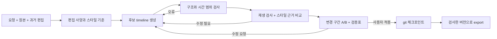

# TRINIX 조사와 Cutline 적용 제안

1. 찾던 제품은 **엔닷라이트(NdotLight)의 트리닉스(TRINIX)**다. “N.light / Trinx”는 부정확하게 기억한 명칭으로 판단된다. **[높음]** [회사 소개](https://www.linkedin.com/company/ndotlight), [한국어 공식 소개](https://ndotlight.com/ko/newsroom/sedaily-interview)
2. 공개된 흐름은 기존 CAD/텍스트/이미지 → 부품 구조 → 물리·관절 속성 → 충돌 형상 → 시뮬레이션용 출력이며, 자연어로 반복 수정한다. **[중간: 공급사 설명]** [디지털 트윈 워크플로우](https://ndotlight.com/solutions/digital-twin)
3. 자동 시뮬레이션 피드백 루프는 명시돼 있지만, TRINIX의 규칙별 검증 보고서·diff·승인 게이트·git 버전 관리는 확인되지 않았다. **[중간/미확인]** [제품 페이지](https://ndotlight.com/)
4. Cutline이 가져올 핵심은 **구조화된 편집 결과를 사양에 검사하고, 실제 재생으로 확인한 뒤 고치는 반복 과정**이다. **[제안]** [NVIDIA 제작 절차](https://docs.omniverse.nvidia.com/simready/latest/make-a-simready-asset.html)
5. 오늘의 우선순위는 **① 편집 사양+검증표 ② 변경 구간 A/B 미리보기+적용/복원 ③ 근거가 보이는 스타일 비교**다. “창작자와 구분 불가”는 향후 블라인드 평가로 검증할 목표다. **[제안]**

조사 기준일: **2026-11-20, 한국 시간**. 공개 웹 검색과 문서 열람만 수행했다. 제품 설치, 계정 생성, 실제 변환 실행, 영업 문의는 하지 않았다. 영상은 링크·제목·설명 수준에서 확인했으며 화면 전체를 재생해 검증한 것으로 취급하지 않는다. `latest` 문서와 웹사이트는 이후 변경될 수 있다.

**신뢰도 표기:** **높음** = 공식 명칭·문서에 직접 명시된 사실 또는 독립 기관의 직접 기록. **중간** = 회사의 기능·성과 주장으로 실사용 재현은 하지 않음. **낮음/추론** = 공개 단서에 근거한 해석. **미확인** = 이번 조사에서 근거를 찾지 못함이며 기능 부재를 뜻하지 않음. **제안** = Cutline 설계 판단으로 외부 제품의 사실이 아님. 표에서는 행 단위로 적용한다.

## 1. 회사·제품 식별과 근거

| 항목 | 확인 결과 | 신뢰도·출처 |
|---|---|---|
| 회사 | 주식회사 엔닷라이트, NdotLight. NVIDIA 행사에는 NdotLight Co., Ltd.로 표기 | 높음: [공식 채용 소개](https://ndotlight.careers.team/job-descriptions/4bEmxlRzDM), [NVIDIA GTC](https://www.nvidia.com/en-us/on-demand/session/gtc26-ex82250/) |
| 제품 | TRINIX / Trinix / 트리닉스. 대표 박진영(Jinyoung Park, Jay Park), CTO 김선태(Suntae Kim) | 높음: [공식 한국어 소개](https://ndotlight.com/ko/newsroom/sedaily-interview), [NVIDIA AI Day](https://www.nvidia.com/ko-kr/ai-days/session-catalog/?tab.allsessions=1700692987788001F1cG) |
| 명칭 변형 | 회사 자체 영문 기사 제목에도 N.Light가 등장한다. N-Light·Nlight·엔라이트를 공식 회사명으로 확인한 것은 아니다 | 높음: [N.Light 제목의 회사 기사, 2026-06-08](https://ndotlight.com/newsroom/n-light-teams-with-nvidia-to-scale-sim-ready-data-for-physical-ai) |
| 공식 웹·LinkedIn | ndotlight.com, linkedin.com/company/ndotlight | 높음: [웹사이트](https://ndotlight.com/), [LinkedIn](https://www.linkedin.com/company/ndotlight) |
| NVIDIA Inception | 회사는 2022년 가입을 설명한다. NVIDIA 공식 GTC 2026 Inception 피치 페이지에 박진영과 회사명이 직접 나온다. 가입 연도는 회사 주장, 발표 기록은 NVIDIA 측 확인 | 중간/높음: [회사 2025-07-21 기록](https://ndotlight.com/newsroom/ndotlight-connects-design-automation-and-robot-training-with-%E2%80%9Cliving-cad%E2%80%9D), [GTC EX82250](https://www.nvidia.com/en-us/on-demand/session/gtc26-ex82250/) |
| NVIDIA 기술 발표 | AI Day Seoul 2026의 “From CAD to SimReady: Building the Physical World for AI [AD1023]”, 11월 9일. 김선태와 NVIDIA Jens Jebens 공동 세션. OpenUSD 변환, 물리 속성, 벤치마크 기반 자동 검증을 발표 주제로 기재 | 높음: [NVIDIA 공식 세션 카탈로그](https://www.nvidia.com/ko-kr/ai-days/session-catalog/?tab.allsessions=1700692987788001F1cG) |
| GTC 2025 | 당시에는 제조 불량 검출용 3D 합성 데이터와 Surfee 협업 결합 계획으로 보도됐다. 현재 제품 범위와 당시 기능을 동일시하면 안 된다 | 높음: 보도 존재 / 중간: 회사 제공 내용. [머니투데이 2025-03-19](https://www.mt.co.kr/future/2025/03/19/2025031913274868945) |
| YouTube | “TRINIX by NdotLight”, 2025-09-24 영상과 공식 홈페이지 연결 데모·채널 확인 | 높음: 링크 존재. [소개 영상](https://www.youtube.com/watch?v=SwIrg2iTf1A), [홈페이지 연결 데모](https://www.youtube.com/watch?v=J3Cbu-37sVw), [공식 연결 채널](https://www.youtube.com/@ndotlight-trinix) |

**판정 [높음]:** 회사·제품은 실재하고 사용자 설명과 매우 잘 맞는다. 다만 “NVIDIA 파트너”라는 표현을 모든 출력물의 인증이나 공식 검증 통과로 확대하면 안 된다. NVIDIA 행사 기록은 확보했지만, 이번 조사에서는 별도의 NVIDIA 파트너 디렉터리에서 계약 등급이나 제품 인증을 확인하지 못했다.

## 2. TRINIX의 실제로 공개된 프로세스

아래는 공개 제품 설명을 연결한 워크플로우이며 직접 체험한 UI 클릭 순서가 아니다. 특히 “자동”은 공급사가 주장하는 범위이고, 단계마다 사람이 승인하는지는 별도 표시했다.

| 단계 | 입력·처리·결과 | 자동화와 사람의 역할 | 신뢰도·근거 |
|---|---|---|---|
| 1. 시작 | 기존 CAD 업로드 또는 텍스트·이미지에서 생성 | 사람이 원본과 의도 제공. CAD 입력 확장자의 완전한 지원표는 미확인 | 중간: [Digital Twin](https://ndotlight.com/solutions/digital-twin) |
| 2. 요구 지정 | 기존 CAD에서 보존해야 할 세부 요소를 설명 | 사람이 보존 의도 지정. 이를 기계 실행 가능한 사양으로 저장하는지는 미확인 | 중간: 같은 페이지의 “Describe What Matters” |
| 3. 구조 생성·복원 | 부품 구성 재구성, 조립 가능한 CAD 생성 | 자동 생성. 부품별 승인 UI는 미확인 | 중간: [Digital Twin](https://ndotlight.com/solutions/digital-twin), [Industrial Design](https://ndotlight.com/solutions/industrial-design) |
| 4. 대화·수치 수정 | 자연어로 밸브 손잡이 수, 문·서랍 동작 등을 수정. 수치 파라미터로 정밀 조정 | 사람이 추가 요구를 주고 시스템이 수정. 매 수정 전 diff 확인은 미확인 | 중간: [Living CAD](https://ndotlight.com/newsroom/ndotlight-connects-design-automation-and-robot-training-with-%E2%80%9Cliving-cad%E2%80%9D), [Industrial Design](https://ndotlight.com/solutions/industrial-design) |
| 5. 물리 정보 보강 | 관절·물리·재질 속성 추론 및 주입 | 자동 처리 주장. 재질·질량 추론이 실측과 일치하는지 사람이 확정하는 절차는 미확인 | 중간: [Robotics](https://ndotlight.com/solutions/robotics) |
| 6. 시뮬레이션 준비 | 시각용 mesh와 충돌용 mesh 분리 | 자동 처리. 필요 시 대량 변형 생성도 제공한다고 설명 | 중간: [Robotics](https://ndotlight.com/solutions/robotics) |
| 7. 실행·검증·수정 | 시뮬레이션에서 물리 데이터 문제를 찾으면 자동 수정하고 재실행하는 closed loop | 자동 피드백 주장. 실패 기준·수렴 조건·최대 반복 횟수·사람 승인 단계는 미확인 | 중간: [제품의 Self-corrective Closed Loop](https://ndotlight.com/); 검증 주제는 [NVIDIA AD1023](https://www.nvidia.com/ko-kr/ai-days/session-catalog/?tab.allsessions=1700692987788001F1cG)에도 명시 |
| 8. 출력·사용 | USD·URDF·MJCF 및 CAD 형식으로 출력. Isaac Sim 등에서 사용 | 출력 기능 확인, 출력 전 필수 승인·검증 통과 차단 여부는 미확인 | 중간: [제품 FAQ](https://ndotlight.com/) |

**중간 검사·미리보기 [중간/미확인]:** 제품은 시뮬레이션에서 작동·검증하는 흐름을 제시한다. 그러나 채팅 옆 실시간 뷰포트, 변경 전후 동기 재생, 단계별 녹색 체크, 실패 항목 클릭 이동을 확인한 자료는 없다. 홈페이지 파이프라인 도식을 실제 진행률 UI로 해석하지 않았다. [공개 워크플로우](https://ndotlight.com/solutions/digital-twin)

**사양 기반 검증 [중간/미확인]:** 자동 물리 검증의 방향은 공개돼 있다. 그러나 TRINIX가 NVIDIA Asset Validator 또는 `simready-validate`를 내부에서 호출하는지, 어떤 Profile·버전을 검사하는지, semantic label을 자동 생성·검증하는지, 규칙별 보고서를 제공하는지는 확인되지 않았다. **“SimReady를 생성한다”와 “특정 공식 Profile의 모든 검사를 통과했다”는 서로 다른 주장이다.**

**버전 관리 [미확인]:** TRINIX의 git·branch·commit·rollback·대화별 버전 기능 근거는 찾지 못했다. Surfee와 협업을 결합한다는 발표는 있지만, 이를 TRINIX의 버전 관리 구현 증거로 쓰지 않는다. [회사 발표](https://ndotlight.com/newsroom/ndotlight-connects-design-automation-and-robot-training-with-%E2%80%9Cliving-cad%E2%80%9D)

### 고객·가격·사업 모델

| 항목 | 판단 | 근거·신뢰도 |
|---|---|---|
| 대상 고객 | 로봇 학습 데이터 팀, 제조·설비 디지털 트윈 팀, 산업 제품 설계자 | 중간: [Robotics](https://ndotlight.com/solutions/robotics), [Digital Twin](https://ndotlight.com/solutions/digital-twin), [Industrial Design](https://ndotlight.com/solutions/industrial-design) |
| 구체적 거래 사례 | KT 산업 환경용 케이블·변형체 시뮬레이션 자산 구축·공급을 발표 | 중간: 공급사 발표이며 계약 규모·고객 측 검수 결과는 미확인. [2026-11-09 회사 발표](https://ndotlight.com/newsroom/kt) |
| 판매 방식 | 데모 예약·회사명 포함 문의 폼. 자산 공급 사례를 고려하면 기업별 솔루션/데이터 공급 중심으로 해석 가능 | 높음: 문의 경로 / 낮음: 매출 모델 해석. [공식 문의](https://ndotlight.com/contact-us) |
| 가격 | 공개 정가·좌석 요금·API 단가·무료 체험 범위를 확인하지 못함. 견적 문의 경로는 있으나 반드시 맞춤 견적만 판매한다고 단정할 수 없음 | 미확인: 공식 웹·문의·가격 검색 범위 |
| 설치 형태 | 다운로드형 IDE, 웹 SaaS, 온프레미스 옵션의 제공 범위를 확정할 공개 자료 부족 | 미확인. Surfee의 웹 기반 설명을 TRINIX 배포 형태로 전용하지 않음 |

**성과 수치 주의 [중간]:** 2026-03-16 회사 발표는 데이터 생성 시간 70% 이상 절감·로봇 학습 성공률 3배 이상을 주장한다. 공개 평가 데이터와 비교 조건을 확보하지 못했으므로 Cutline 효과 추정에 사용하지 않는다. [해당 발표](https://ndotlight.com/jp/newsroom/ndotlight-selected-to-present-at-the-nvidia-gtc-2026-inception-demo-pitch)

## 3. NVIDIA SimReady: 무엇을 검사하는가

### 정의와 요구사항의 범위

**[높음: NVIDIA 문서]** SimReady는 OpenUSD 기반 자산에 시뮬레이션에 필요한 구조·속성을 갖추게 하는 사양 체계다. 시각적 형상만으로는 부족하며, 용도에 따라 물리 속성·semantic label·센서 관련 정보 등의 모듈이 필요하다. **USD 파일로 저장했다는 사실만으로 시뮬레이션 적합성이 증명되지는 않는다.** [공식 개요](https://docs.omniverse.nvidia.com/simready/latest/index.html), [사양 설명](https://docs.omniverse.nvidia.com/simready/latest/overview/simready-spec.html)

| 검사 영역 | 확인할 내용 | Cutline에 주는 의미 |
|---|---|---|
| 구조·단위·참조 | USD 구조, 스케일·축, 참조·의존 파일, 필요한 schema | JSON 문법뿐 아니라 clip 참조·시간 단위·미디어 존재 검사 |
| 물리 | 충돌 형상, 질량·물리 재질, 관절 등 해당 용도 요구 | 클립 길이·소스 범위·전환 가능 구간 등 실제 작동 조건 검사 |
| 시각 재질 | PBR 재질, 텍스처, 바인딩 등 렌더링용 정보 | 자막 스타일·레이아웃·렌더링 리소스 검사 |
| 의미 정보 | semantic label 등 학습·인식용 메타데이터 | 클립 역할·화자·장면 의도를 구조화해 편집 판단에 사용 |

앞 표의 NVIDIA 항목은 **[높음]**, Cutline 열은 **[제안]**이다. 물리 재질과 시각 재질은 역할이 다르며, 모든 물체에 관절이나 모든 종류의 라벨을 강제하는 공통 체크리스트로 읽으면 안 된다. [제작 가이드](https://docs.omniverse.nvidia.com/simready/latest/simready-asset-creation.html), [Simulation Needs](https://docs.omniverse.nvidia.com/simready/latest/sim-needs.html)

**[높음]** 현재 공식 FAQ는 `Requirement → Feature → Profile` 구조와 이를 분류하는 Capabilities를 설명한다. Profile은 목적별 요구 묶음이고, 각 Requirement는 식별 가능한 규칙이다. 예를 들어 `Prop-Robotics-Neutral`과 특정 runtime용 Profile은 검사 범위가 다르다. 따라서 검증 결과에는 **대상 Profile과 버전**이 따라야 한다. [공식 FAQ](https://docs.omniverse.nvidia.com/simready/latest/simready-faq.html)

### 공식 검증 도구와 한계

| 도구·절차 | 역할과 확인 범위 | 신뢰도·출처 |
|---|---|---|
| SimReady Foundation | 요구사항·Profile 기반 검증, runtime 테스트 및 관련 기반을 제공. 저장소에 `simready-validate` 등 명시 | 높음: [NVIDIA 저장소 README](https://github.com/NVIDIA/simready-foundation/blob/main/README.md) |
| Omniverse Asset Validator | USD 품질·준수 규칙 검사. standalone 또는 Kit에서 활용 가능 | 높음: [NVIDIA FAQ 도구 설명](https://docs.omniverse.nvidia.com/simready/latest/simready-faq.html) |
| Asset Validator의 SimReady 규칙 | 규칙 패키지·대상 자산 범위에 주의. 해당 문서는 AV 콘텐츠 규칙 및 `omni.cip.core` 분리를 명시하므로 모든 robotics Profile 검사와 동일시할 수 없음 | 높음: [Omni Asset Validator (SimReady)](https://docs.omniverse.nvidia.com/kit/docs/asset-validator/latest/source/extensions/omni.asset_validator.core/docs/simready/index.html) |
| 반복 제작 | USD 변환 → 목적 Profile 선택 → 검사 → 수정·재검사 → runtime별 적응 | 높음: [Make a SimReady Asset](https://docs.omniverse.nvidia.com/simready/latest/make-a-simready-asset.html); 이 페이지 직접 열람은 cache miss였고 검색 색인 본문으로 확인 |
| 조립 장면·runtime 검증 | 개별 자산 검사와 조립된 장면의 연결·단위·설정, 실제 시뮬레이션 동작 확인은 구분해야 함 | 높음: [Validate a Composed SimReady Scene](https://docs.omniverse.nvidia.com/simready/latest/validate-a-simready-scene.html) |
| 배포 증거 | SimReady Central은 검증·필요 runtime 시험 증거, 라이선스와 특정 dataset commit을 연결하는 게시 절차를 설명 | 높음: [SimReady Central](https://docs.omniverse.nvidia.com/simready/latest/simready-central.html) |

**[높음]** 정적 검사는 구조와 속성의 적합성을 확인한다. 실제 동작을 보장하려면 runtime 평가가 추가로 필요하다. 공식 FAQ는 현재 전체 조립 장면의 포괄적 SimReady 사양·validator가 아직 정의되지 않았다고 설명한다. “모든 것이 자동 인증된다”는 해석은 부정확하다. [FAQ의 scene validation 설명](https://docs.omniverse.nvidia.com/simready/latest/simready-faq.html)

**[제안]** Cutline에서도 세 층을 분리해야 한다: **파일이 유효한가 → 렌더링·재생이 정상인가 → 창작자의 편집 감각과 맞는가.** 마지막 질문은 JSON 검사 통과만으로 답할 수 없다.

## 4. 유사 제품 4개: 대화 → 구조화된 결과 → 확인·수정

검증은 제품마다 강도가 다르다. SQL이 실행됐다는 사실, CAD 엔진이 모델을 만들었다는 사실, 브라우저 테스트가 통과했다는 사실을 각각 사업적 정답·제조 안전성·완벽한 품질로 확대하지 않는다.

| 제품·영역 | 확인된 흐름과 preview | 검증·한계 | 가져올 패턴 / 신뢰도 |
|---|---|---|---|
| **Zoo Design Studio / Zookeeper — CAD** | 채팅·선택한 형상 → 편집 가능한 KCL/파라메트릭 모델 → 모델 뷰와 다중 시점 snapshot → 반복 수정 | CAD 엔진 실행·디버깅, 형상·질량/부피 같은 도구 기반 확인. 상세 물리 시험·안전 보장은 범위 밖 | `timeline.json`을 모델의 원본으로 삼고, 에이전트가 결과 프레임도 보게 한다. **높음: 문서상 기능, 실사용 미검증.** [연구 설명](https://zoo.dev/research/zookeeper), [FAQ](https://zoo.dev/docs/faq?showSignUp=true) |
| **Replit Agent — 앱** | 요청 → 코드/작업 → 실행 preview → 브라우저 App Testing·수정. checkpoint와 복원 지원 | 실제 클릭·입력으로 기능 확인, 테스트 replay. 모든 요청마다 시험하지는 않음. Task board는 작업 로그·시험·preview를 검토하고 main에 적용하는 흐름 제시 | 변경 묶음별 preview, 검증 로그, 적용과 복원. **높음: 문서상 기능.** [App Testing](https://docs.replit.com/features/agent/app-testing), [체크포인트](https://docs.replit.com/replit-workspace/workspace-features/version-control), [Task board](https://docs.replit.com/references/agent/task-board) |
| **Hex Threads — BI** | 자연어 질문 → semantic model/데이터 조회 → SQL 실행 → 표·차트. 도구 실행·결과를 실시간 표시하고 Notebook에서 이어 작업 | SQL과 결과를 검토할 수 있지만 지표 정의나 인과 해석의 정답을 보장하지 않음. 기존 프로젝트를 문맥으로 활용 | 스타일 판단에 실제 과거 편집을 연결하고, 결론에서 측정값·근거로 내려갈 수 있게 한다. **높음: 기능 / 제안: 전이.** [Threads](https://learn.hex.tech/docs/explore-data/threads), [프로젝트 문맥](https://learn.hex.tech/changelog/2026-03-24) |
| **Lovable — 웹 디자인·앱** | 프로젝트 채팅 → 앱 preview → 실제 브라우저 동작·화면 크기 확인 → screenshot·로그·수정 | 현재 preview 버전을 검사. Details에 단계·결과 표시. 미묘한 색상·디자인 차이 판단은 신뢰하기 어렵다고 명시 | 검사한 버전과 보여주는 버전을 일치시키고, 자동 검증 결과와 사람의 미감 판단을 구분. **높음: 문서상 기능.** [Browser testing](https://docs.lovable.dev/features/browser-testing) |

**[제안]** Cutline의 외형과 구조에 가장 가까운 사례는 Zoo, 변경 적용·복원 UX는 Replit, 기존 작업을 문맥으로 활용하는 방식은 Hex다. TRINIX의 핵심 기여는 도메인 데이터 보강과 실행 피드백 루프다.

## 5. Cutline 적용 우선순위

모든 Cutline 항목·비용·피치 문구는 **[제안]**이다. 기존 VSCodium 확장, `timeline.json` 로더, 재생 패널, git 연결이 이미 작동한다는 가정이다. 이 기반까지 하루에 새로 만드는 일정은 아니다. **S = 약 1–2시간, M = 반나절–1일, L = 여러 날 이상**의 대략적 구현 범위이며 합산 확약이 아니다.

| 순위 | 원본에서 확인한 패턴 | Cutline 구현 | 오늘 / 이후 노력 | 피치 가치 |
|---|---|---|---|---|
| **1** | NVIDIA Profile별 규칙 검사. TRINIX 내장 구현은 미확인 | `edit-spec.json`의 길이·화면비·금지사항과 `style.md`를 읽어 hard fail / style warning / 미평가로 나눈 검증표. `clipId`, 시간, 기대값·실측값·수정 이유 제공 | **S**: 고정 5개 규칙 / **L**: 채널별 Profile·버전·증거 관리 | “AI가 끝냈다고 말하는 대신, 무엇을 만족했는지 보여준다.” |
| **2** | Replit의 preview·검토 후 적용과 checkpoints | 후보 timeline을 별도 저장, 변경 구간 A/B 재생, “적용 / 되돌리기”. diff는 JSON 줄 대신 “0:12–0:15 침묵 제거”처럼 표현 | **M**: 전체 후보 적용·기존 git 복원 / **L**: 개별 변경 선택·시간축 대응 | “무엇이 바뀌는지 보고 결정하고, 언제든 돌아간다.” |
| **3** | Hex의 기존 프로젝트 문맥, Zoo의 프로젝트 지침·모델 기반 측정 | 과거 편집의 컷 길이·자막·줌·전환 분포와 비교. 규칙마다 원본 예시와 근거 표시. `style.md` 갱신 제안은 창작자 승인 후 반영 | **S**: 수동 추출한 소수 기준과 비교 / **L**: 자동 추출·장르별 보정·블라인드 평가 | “내 채널의 기존 편집이 다음 편집의 기준이 된다.” |
| **4** | TRINIX의 생성→실행→물리 수정→재실행 | JSON 검사 → 짧은 렌더/재생 → 오류가 있는 구간만 수정 → 재검사. 최대 2회 등 반복 예산 설정 | **M**: 구조 오류 자동 재시도 / **L**: 영상·음성 품질 자동 평가 | “파일을 쓰고 끝내지 않고 결과를 확인한다.” |
| **5** | TRINIX의 부품 단위 데이터, Zoo의 선택 문맥 | 안정적인 `clipId`와 화자·장면 역할, 선택 구간 문맥. “이 반응은 살리고 여기만 짧게”가 대상 구간에만 적용 | **M**: 선택 구간과 ID 전달 / **L**: 의미 단위 분할·의존 관계 | “창작자의 의도를 클립 단위로 보존한다.” |
| **6** | Hex/Lovable의 실행 단계·도구 결과 표시 | 읽기→계획→수정→검증→미리보기 상태. 실제 완료 이벤트에 연결하고 실패 구간으로 이동 | **S**: 실제 이벤트 표시 / **M**: 단계별 재시작·소요 시간 | “지금 무엇을 하고 어디서 막혔는지 보인다.” |
| **7** | SimReady Central의 검증 증거·배포 버전 결합 | export에 timeline hash·spec/style 버전·미디어 목록·검증 결과 기록. 변경 후에는 기존 통과 상태 무효화 | **S**: JSON 보고서 / **M**: 재현 가능한 렌더 manifest | “어떤 기준으로 통과한 어떤 편집인지 추적한다.” |
| **8** | TRINIX의 파라미터 변형 생성 | 원본을 공유하는 ‘빠른 템포 / 원래 템포’ 2안과 비교표. 승인된 안만 저장 | **M**: 2안 / **L**: 비용을 통제한 탐색·개인화 | “추상적인 취향 질문 대신 실제 편집 두 개를 비교한다.” |

원본 근거: [TRINIX Robotics](https://ndotlight.com/solutions/robotics), [TRINIX closed loop](https://ndotlight.com/), [Zoo 프로젝트 지침·선택 문맥](https://zoo.dev/docs/zoo-design-studio/zookeeper), [Replit Task board](https://docs.replit.com/references/agent/task-board), [Hex Threads](https://learn.hex.tech/docs/explore-data/threads), [NVIDIA 검증](https://docs.omniverse.nvidia.com/simready/latest/make-a-simready-asset.html), [SimReady 배포](https://docs.omniverse.nvidia.com/simready/latest/simready-central.html).

### 제안하는 편집 루프

**[제안]** 에이전트가 쓰는 파일과 사용자가 재생하는 파일을 같은 후보 revision에 묶는다. 검사 이후 파일이 바뀌면 검증 상태를 만료시킨다. 기존 편집을 복구하는 데 필요한 미디어는 git commit만으로 보존되지 않을 수 있으므로, 나중에는 미디어 참조·hash까지 기록한다. 이는 TRINIX의 확인된 구현이 아니라 Cutline에 필요한 설계다.

### 검증표의 구체적 예시

다음 수치와 결과는 **설계 예시이며 실제 사용자 영상의 측정값이 아니다.**

| 규칙 | 종류 | 예시 결과 | 사용자 행동 |
|---|---|---|---|
| 소스 범위 이탈 없음 | hard | FAIL: `clip_07`, 요청 out 14.2초, 소스 길이 13.8초 | 자동 수정 후 재검사 |
| 최종 길이 30초 이하 | hard, 이번 요청에 명시된 경우 | PASS: 28.4초 | 결과 길이 확인 |
| 자막 최대 2줄 | hard 또는 warning, 사양에 명시 | WARN: 0:18에서 3줄 | 해당 프레임 열기 |
| 해당 채널의 일반 컷 길이 범위 | style | WARN: 비교 편집 대비 긴 컷 2개 | 두 구간과 과거 예시 A/B |
| 창작자 특유의 유머 타이밍 | 사람 평가 | 미평가 | 창작자 확인 요청 |

**[제안] 스타일 점수 원칙:** 하루 데모에서는 “전체 스타일 92점”보다 항목별 측정과 근거를 보여준다. 미평가 항목을 통과로 계산하지 않는다. 이후 점수가 필요하면 기준 데이터·가중치·비교 장르·표본 수를 노출한다. 과거 편집의 평균에 가까운 것만으로 훅·서사·유머·감정선까지 같아지는 것은 아니다.

## 6. 오늘 만들 Top 3와 완료 기준

### 1) 편집 사양 + 검증표

**[제안]** 사용자의 요청을 3–5개 조건으로 표시하고, 에이전트가 변경한 `timeline.json`에 대해 필수 필드·존재하는 clip 참조·소스 범위·최종 길이·자막 규칙을 검사한다. UI에는 실제로 계산한 결과만 넣는다. 실패 항목은 관련 시간으로 이동할 수 있게 한다.

**완료 기준:** 의도적으로 소스 범위를 넘는 후보를 검사하면 export 준비 완료가 되지 않고, 해당 clip과 원인을 보여준다. 정상 후보는 실제 검사 결과로 통과한다. 구현 부담이 크면 자동 수정은 다음 단계로 남긴다.

### 2) 변경 구간 미리보기 + 적용/복원

**[제안]** 전체 후보를 대상으로 원본/후보 전환 재생과 자연어 변경 목록을 제공한다. 오늘은 개별 hunk 선택보다 전체 후보 적용을 우선한다. 삭제로 시간축이 달라진 경우에는 단순히 같은 초를 재생하지 말고 해당 clip ID 또는 소스 구간을 맞춘다.

**완료 기준:** 침묵 제거 요청 → 변경 구간 재생 → 적용 → 복원 → 원본 timeline이 복구되는 시연이 가능하다. 검사한 후보와 적용한 후보가 같은 revision임을 확인한다.

### 3) 과거 편집에 근거한 스타일 비교

**[제안]** 데모용 과거 편집 2–3개의 기준을 미리 준비하고, 컷 길이·자막 규칙·전환 사용 같은 소수 항목을 `style.md`에 기록한다. 자동 학습을 구현하지 않았다면 수동 설정이라고 명시한다. 새로운 후보에서 이탈한 구간과 비교 예시를 보여준다.

**완료 기준:** “내 채널처럼”이라는 요청이 어떤 기준으로 해석됐는지와 아직 사람이 판단해야 할 부분을 설명할 수 있다. 익숙한 편집과의 유사성 주장은 오늘의 데모 목표이며, 달성된 검증 결과로 발표하지 않는다.

**시간이 부족할 때 [제안]:** 1번 검증표와 2번 후보 재생을 끝낸 뒤 3번을 수동 기준 2개로 축소한다. 대규모 스타일 학습, 복잡한 평가 모델, 다중 후보 탐색은 뒤로 미룬다. 이후에는 학습에 쓰지 않은 영상에서 창작자·시청자 블라인드 비교, 승인율, 수동 수정량, 최종본까지 걸린 시간으로 효과를 평가한다.

**피치 문장 [제안]:** “Cutline은 내 과거 편집을 기준으로 타임라인을 수정하고, 바뀐 장면과 검사 결과를 함께 보여주는 영상 편집 IDE입니다.”

## 7. 남아 있는 확인 사항

다음은 후속 데모에서 확인할 항목이다. 이번 작업에서 회사에 연락하지 않았다.

- **TRINIX 검증:** Profile 이름·버전, validator 실행 로그, 실패 보고서 샘플, static/runtime 구분, semantic label 처리, 실제 물리값의 근거.
- **UI:** 실행 중 단계 표시, 변경 전후 비교, 부품 선택과 채팅 연결, 승인 지점, 오류 시 재시도·중단 방법.
- **재현성:** 모델·파라미터·프롬프트 이력, 버전 복원, 입력 CAD 보존, export에 검증 증거 포함 여부.
- **도입:** 지원 입력 형식·제약, 설치/웹/온프레미스 형태, API, 가격 단위, 서비스 제공과 소프트웨어 라이선스의 구분.
- **영상 증거:** 홈페이지 데모와 GTC 녹화의 실제 화면·타임스탬프 검토. 현재 보고서는 영상을 보았다는 전제의 UI 주장을 포함하지 않는다.

검색에는 `Trinx CAD SimReady Nlight`, `엔라이트 트링스 SimReady`, `TRINIX 트리닉스`, `site:nvidia.com NdotLight`, 제품 가격·LinkedIn·YouTube 및 NVIDIA 공식 검증 문서 질의를 사용했다. 검색 결과의 상대 날짜 대신 가능한 경우 본문 날짜를 사용했다. 외부 문서가 제공한 설치 명령은 실행하지 않았고, 산출물은 이 보고서 한 파일이다.
